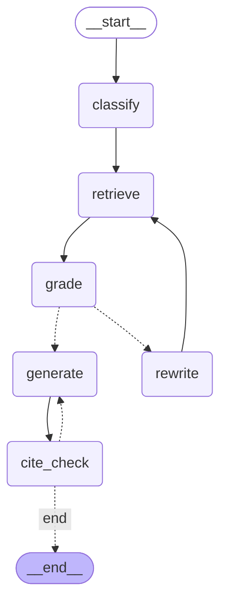
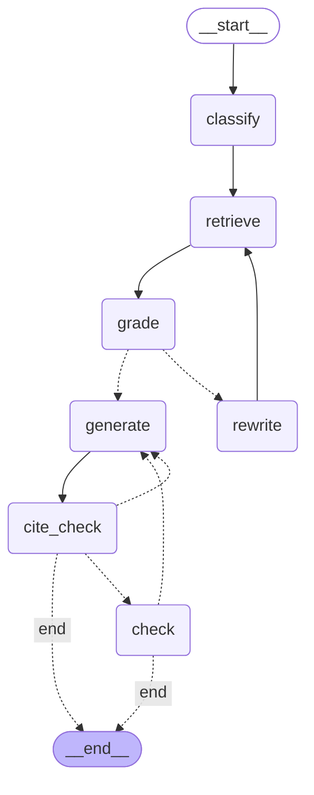

<!--
GUIDE: 제출물 "Agent 그래프 구조도". 각 노드의 역할, 노드 간 흐름과 분기, 종료 조건을 적는다.
- 지금은 구현 전 초안이다. 구현 후에는 LangGraph에서 생성한 mermaid(graph.get_graph().draw_mermaid())로 2절을 바꾸고,
  초안과 달라진 점을 4절에 남긴다.
- 노드 구성을 바꾸면 PROCESS.md 8절에 이유(실패 분석의 어떤 유형 때문인지, 문항 ID)를 적는다.
이 안내 주석은 채운 뒤에도 지우지 않는다.
-->

# Agent 그래프 구조도

상태: 구현 완료 (2026-10-21, `src/rag/agent.py`, LangGraph). 2026-10-22: 검색 노드가 T2와 같은 rerank를 거치고 답변 프롬프트는 설정을 따른다(최종 T3는 `answer_v4`). 아래 dev 결과(카드 008)는 이전 설정(v1, rerank 없음)의 값이다. 초안과 달라진 점은 6절

## 1. 설계 의도

- 기본 RAG와 같은 답변 프롬프트(`prompts/answer_v1.md`)와 같은 답변 함수(`rag.generate_answer`, `map_citations`, `format_answer`), 같은 검색기(`retrieval.load_retriever`)를 쓴다. 차이는 아래 구조뿐이다(PLAN.md 3.3절).
- 기본 RAG가 LLM 1회로 하던 판단을 나눈다: 답할 질문인지(classify), 근거가 충분한지(grade), 인용이 맞는지(cite_check).
- 근거가 부족하면 질문을 고쳐 다시 검색한다(rewrite → retrieve, 최대 2회).

## 2. 그래프

`Agent.graph.get_graph().draw_mermaid()`로 만든 구현 그래프다(점선은 조건 분기).

- classify: 질문 유형 4가지(document / needs_info / inappropriate / injection). needs_info·inappropriate는 grade를 건너뛴다(근거 충분성 판단 없이 바로 generate).
- grade: 누적 문맥으로 답할 수 있는지 판단. 부족하고 재검색이 2회 미만이면 rewrite → retrieve. 2회 다 쓰면 그대로 generate (보류는 답변 프롬프트가 고른다).
- generate: 기본 RAG의 답변 단계(`answer_v1`). cite_check: 인용 번호가 문맥 밖이거나 `answered`인데 인용이 없으면 generate를 1회 더 한다.

## 3. 노드

| 노드 | 역할 | LLM | 출력 |
|---|---|---|---|
| classify | 질문 유형 4가지 중 하나 (`prompts/agent_classify_v1.md`) | 1회 | 유형, 이유 |
| retrieve | 기본 RAG와 같은 검색(`BaselineRAG.retrieve`: Hybrid 후보 15개 → LLM rerank로 5개, 2026-10-22부터). 결과를 누적 문맥에 더한다(중복 제거, 총 10개까지) | 0 (임베딩만) | 청크 목록 |
| grade | 누적 문맥으로 답할 수 있는지 판단 (`agent_grade_v1.md`). needs_info·inappropriate는 건너뜀 | 0–1회 | 충분 / 부족 + 부족한 점 |
| rewrite | 부족한 점을 바탕으로 새 검색어 (`agent_rewrite_v1.md`), 최대 2회 | 0–1회 | 검색어 |
| generate | 기본 RAG와 같은 답변 단계 (`answer_v1.md`): status, 답변, 인용 번호 | 1회 | status, answer, citations |
| cite_check | 인용 번호가 실제 문맥 안에 있는지, `answered`에 인용이 있는지 코드로 확인 | 0 | 통과 / 실패 (실패 시 generate 1회 재시도) |

## 4. 종료 조건

- END는 cite_check 다음에만 도달한다. 최종 status 4가지(answered / abstained / clarify / refused)는 generate가 답변 프롬프트로 고른다.
- 재검색은 최대 2회, 인용 재시도는 최대 1회. 최악의 경우 LLM 호출은 8회(classify 1, grade 3, rewrite 2, generate 2)다. dev 90문항 실측은 문항당 평균 3.16회, 최대 검색 3회.

## 5. 측정 장치 (구현 전에 정함)

- 첫 검색 문맥과 누적 문맥을 따로 `metrics.context_metrics`로 채점한다. Agent의 첫 검색은 같은 질문에 대한 기본 RAG의 검색과 같으므로 직접 비교한다.
- 답변이 재검색으로만 찾은 청크를 인용했는지 기록한다(재검색의 효과를 문항 단위로 확인).
- 노드마다 판단, 모델, 토큰, 시간을 `steps`에 남긴다.

## 6. 초안과 달라진 점

- **refuse / clarify / abstain 노드를 만들지 않았다.** 이유: (1) 답변 프롬프트가 이미 `status`와 거절·되묻기·보류 문장을 쓰며, 그 문장이 문서 인용(일반 정보 안내)을 필요로 해서 검색을 거쳐야 한다. (2) 같은 프롬프트를 쓰기로 한 설계(PLAN.md 3.3절)를 지키기 위해 별도 프롬프트를 더하지 않았다. 대신 classify가 needs_info·inappropriate 질문의 grade·재검색을 건너뛰게 한다.
- **classify는 질문을 고쳐 쓰지 않는다.** 첫 검색이 기본 RAG의 검색과 같아야 직접 비교가 되기 때문이다(5절). 주입 문구는 답변 프롬프트의 규칙 4가 처리한다.
- **누적 문맥 상한 10개**를 추가했다(첫 검색 5 + 새 청크 최대 5). 재검색을 두 번 해도 답변 입력이 3배로 늘지 않게 하기 위해서다.
- 노드 구성을 바꾼 근거는 실패 분석(PROCESS.md 6절)의 "근거 부족" 25문항(검색 실패 7, 근거 일부 누락 13, 과잉 보류 5)을 재검색 노드가 겨냥하고, negative 6문항(NEG014 NEG025 NEG037 NEG039 NEG022 NEG023)은 공통 답변 단계가 다룬다는 판단이다.
- dev 결과(카드 008): 점수 0.822 → 0.856, 순승 +3으로 오차 범위. 재검색은 9문항, 그중 3문항이 재검색으로만 찾은 청크를 인용했다.

## 7. 시도했지만 채택하지 않은 판: Agent v2 (카드 014, 2026-10-22)

최종 체인에서는 검색이 거의 다 맞고(dev page_hit@5 0.99), 틀리는 이유는 찾은 근거를 답에서 빠뜨리는 것이었다(T2 dev 만점 아닌 12문항 중 10문항). 그래서 v1 그래프 끝에 답변 검사 노드를 붙이고, v1이 버리던 분류 결과를 답변 단계에 넘겼다. 설정 `configs/014-agent-v2.yaml`, 모두 설정으로 켜고 끄므로 T3 설정은 그대로 재현된다.

| 바뀐 것 | 내용 |
|---|---|
| generate에 메모 전달 | classify의 질문 유형·이유, 마지막 grade가 부족이면 "근거 부족: 검색 N번 뒤에도 부족 - 무엇이". 답변 프롬프트 `answer_v5` = v4 + 규칙 12(메모는 참고, status는 규칙 5로 직접 정함) |
| check 노드 (`agent_check_v1.md`, `gemini-3.8-flash`) | cite_check를 통과한 초안을 읽고 빠진 부분·빠진 단서·결과에 없는 숫자·대응 방식 오류를 찾는다. 지적이 있으면 generate가 지적과 초안을 메모로 받아 1번 고쳐 쓴다. 고쳐 쓴 답은 다시 검사하지 않는다 |
| 종료 이유 | `steps.termination_reason` = completed / revised / insufficient_evidence |
| 만들지 않은 것 | 고정 문구 보류 노드(수업 23번): v1 dev에서 근거 부족으로 끝난 4문항 중 ADD-HF06(부분 근거로 만점)과 NEG034(올바른 거절)를 잃게 되어, 부족 상태는 메모로만 넘겼다 |

종료 조건: 재검색 최대 2회(검색 3회), 인용 재시도 최대 1회, 고쳐 쓰기 최대 1회. 최악의 경우 LLM 호출 = classify 1 + rerank 3 + grade 3 + rewrite 2 + generate 4 + check 1.

결과: dev 90에서 0.928로 T2와 같았다(2 / 2 / 86). check가 지적한 것은 3문항뿐이고 겨냥한 10문항은 하나도 지적하지 않았다. 자작 41문항에서는 고쳐 쓴 문항이 0이었다. 비용은 T2의 1.5배라 채택하지 않았다. 자세한 수치는 [카드 014](../experiments/014-agent-v2.md).
